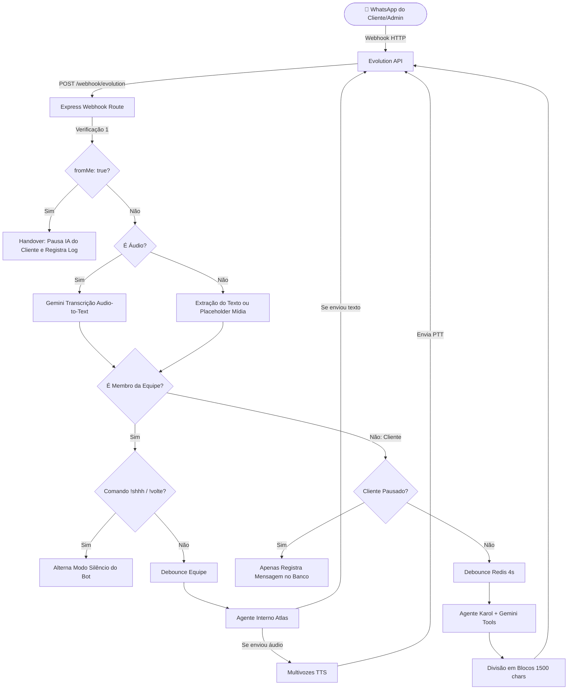

# ⚖️ SaaS Advocacia Backend (Node.js + TypeScript)

<div align="center">


<br/>

**Serviço corporativo de alta performance, projetado para substituir por completo os fluxos legados do n8n no atendimento jurídico automatizado via WhatsApp.**

*Inspirado na arquitetura modular de voz do `inovar_assistente_voz`.*

</div>

---

## 📑 Sumário

- [Visão Geral & Motivação](#-visão-geral--motivação)
- [Comparativo: Antigo n8n vs Novo Backend](#-comparativo-n8n-vs-novo-backend)
- [Arquitetura & Fluxo de Mensagens](#-arquitetura--fluxo-de-mensagens)
- [Os Dois Agentes de IA](#-os-dois-agentes-de-ia)
  - [1. Karol (Atendimento Externo a Clientes)](#1-karol-atendimento-externo-a-clientes)
  - [2. Atlas (Assistente Interno da Equipe / Voz TTS)](#2-atlas-assistente-interno-da-equipe--voz-tts)
- [Catálogo de Ferramentas Nativas (Tool Calling)](#-catálogo-de-ferramentas-nativas-tool-calling)
- [Background Jobs & Rotinas Automáticas (Cron)](#-background-jobs--rotinas-automáticas-cron)
- [Estrutura do Projeto](#-estrutura-do-projeto)
- [Modelo de Dados (Supabase / PostgreSQL)](#-modelo-de-dados-supabase--postgresql)
- [Variáveis de Ambiente & Instalação](#-variáveis-de-ambiente--instalação)
- [Guia de Execução & Deploy](#-guia-de-execução--deploy)
- [Integração com Evolution API](#-integração-com-evolution-api)

---

## 🎯 Visão Geral & Motivação

Workflows visuais em plataformas como n8n, quando submetidos a alto volume de mensagens instantâneas (WhatsApp), sofrem com:
1. **Elevado consumo de memória:** 1.5 GB a 2 GB para instâncias medianas.
2. **Latência acumulada:** Múltiplos nós encadeados somam 3 a 7 segundos por resposta.
3. **Instabilidade de concorrência:** Nós de *Wait* e *Debounce* visuais causam condições de corrida e travamentos em horários de pico.

Este backend foi reimplementado em **Node.js 22 + TypeScript estrito**, operando com consumo inferior a **90 MB de RAM**, execução assíncrona orientada a eventos, buffer atômico via Redis e orquestração direta com a API do Google Gemini.

---

## ⚡ Comparativo: n8n vs Novo Backend

| Dimensão | Fluxos Anteriores (n8n) | Novo Backend (Node.js + TS) | Ganho Real |
| :--- | :--- | :--- | :---: |
| **Consumo de Memória** | ~1.500 MB a 2.000 MB | **~85 MB** | **-95% RAM** |
| **Tempo Médio de Resposta** | 3.5 a 6.0 segundos | **0.8 a 1.6 segundos** | **~4x mais rápido** |
| **Tolerância a Mensagens Picadas** | Nós *Wait* com falhas frequentes | **Buffer atômico no Redis (4s)** | Zero mensagens duplicadas |
| **Orquestração de Tools** | Sub-workflows soltos e sem tipagem | **Function Calling nativo com Zod/Gemini** | Execução determinística |
| **Roteamento Equipe / Admin** | Nós misturados com fluxo de lead | **Roteamento isolado por perfil e comando** | Separação limpa |
| **Síntese de Voz (TTS)** | Nós HTTP com bugs de encoding base64 | **Normalização fonética + Multivozes TTS** | Respostas de áudio realistas |
| **Handover Humano** | Desativação manual imperfeita | **Detecção automática de `fromMe: true`** | Pausa instantânea da IA |
| **Agendamento no Calendário** | Nós inativos por falta de credenciais | **Google Calendar v3 oficial (`googleapis`)** | Pronto para OAuth2 |

---

## 🏛️ Arquitetura & Fluxo de Mensagens



---

## 🤖 Os Dois Agentes de IA

### 1. Karol (Atendimento Externo a Clientes)
* **Objetivo:** Recepção, triagem jurídica empática, coleta do nome, qualificação da urgência e conversão de leads.
* **Comportamento:**
  - Linguagem humanizada, acolhedora e ética.
  - Não faz promessas de causas ganhas nem emite pareceres formais conclusivos.
  - Executa as ferramentas de negócio conforme o cliente conversa (salvar nome, agendar consulta, notificar equipe).
  - Respostas longas são automaticamente fatiadas em blocos de até 1.500 caracteres, respeitando pontuação e espaçamento.

### 2. Atlas (Assistente Interno da Equipe / Voz TTS)
* **Objetivo:** Braço direito da equipe jurídica e advogados no WhatsApp.
* **Comportamento:**
  - Responde dúvidas sobre a esteira de atendimentos e status dos clientes.
  - Gera resumos consolidados das últimas 24 horas por cliente.
  - **Suporte a Voz Completo (TTS):** Se o advogado mandar um áudio perguntando *"Como foram os atendimentos de hoje?"*, o Atlas transcreve, consulta o banco, normaliza o texto para fala e responde diretamente com uma mensagem de voz via **Multivozes TTS**.
  - **Comandos de Controle do Bot:**
    - `!shhh`: Pausa o assistente para a equipe.
    - `!volte` (ou qualquer outro comando): Reativa o assistente imediatamente.

---

## 🛠️ Catálogo de Ferramentas Nativas (Tool Calling)

Todas as ferramentas operam de forma autônoma pelo Gemini Function Calling:

| Ferramenta | Agente | Gatilho / Finalidade | Efeito no Sistema |
| :--- | :---: | :--- | :--- |
| `save_client_name` | Karol | Cliente informa como gostaria de ser chamado | Atualiza coluna `name` em `clients` |
| `convert_lead` | Karol | Triagem concluída (área, temperatura, resumo) | Altera status para `triagem_concluida` e notifica grupo de advogados |
| `human_escalation` | Karol | Cliente irritado, caso complexo ou pedido expresso de humano | Altera status para `paused` e alerta a equipe com link `wa.me/` |
| `notify_team` | Karol | Dúvida sobre processo em andamento ou consulta jurídica pontual | Envia notificação ao grupo sem pausar a IA |
| `check_calendar` | Ambos | Consulta de disponibilidade para reuniões ou consultas | Busca slots livres no Google Calendar |
| `schedule_event` | Karol | Confirmação de agendamento de consulta | Cria o compromisso no Google Calendar com Google Meet |
| `search_knowledge_base` | Ambos | Consulta à base de conhecimento jurídica e regras do escritório (RAG) | Busca semântica vetorial na tabela `knowledge_base` (pgvector / Gemini) |
| `get_daily_summary` | Atlas | Solicitação de relatório ou resumo de atendimentos | Agrupa todas as conversas do dia por cliente (exclui equipe) |
| `update_client_status` | Atlas | Mudança manual de status ou reativação de cliente | Altera status com busca tolerante por nome ou telefone |

---

## ⏰ Background Jobs & Rotinas Automáticas (Cron)

O serviço inclui rotinas de segundo plano em Node.js (`src/services/cron.service.ts`) substituindo os workflows independentes de agendamento do n8n:

1. **Daily Follow-up (10:00 da manhã):**
   - Identifica clientes ativos sem interação há mais de 24 horas.
   - Envia mensagem cordial: *"Olá! Notei que não concluímos nosso atendimento ontem. Ainda tem interesse em agendar ou ficou alguma dúvida?"*
   - Marca `followup_sent = true` para evitar reenvios.

2. **Auto-Reativação de Clientes (A cada 1 hora):**
   - Localiza clientes com status `paused` inativos há mais de 12 horas.
   - Reativa automaticamente para o status anterior ou `active`, garantindo que nenhum contato fique esquecido.

---

## 📁 Estrutura do Projeto

```
mcp n8n/
├── src/
│   ├── config/
│   │   └── env.ts                   # Validação de schema de ambiente com Zod
│   ├── integrations/
│   │   ├── evolution.ts             # Cliente HTTP Evolution API (mensagens, áudio, base64)
│   │   ├── google-calendar.ts       # Integração oficial Google Calendar v3 via OAuth2
│   │   ├── redis.ts                 # Conexão ioredis de alta performance
│   │   └── supabase.ts              # Cliente oficial Supabase (@supabase/supabase-js)
│   ├── services/
│   │   ├── agent.service.ts         # Orquestrador do Agente Karol (Gemini 2.5 Flash)
│   │   ├── internal-agent.service.ts# Orquestrador do Agente Atlas (Admin/Equipe + Áudio)
│   │   ├── client.service.ts        # Operações atômicas de clientes (getOrCreate, status)
│   │   ├── cron.service.ts          # Background jobs: Follow-up 24h e Reativação 12h
│   │   ├── debounce.service.ts      # Agrupamento inteligente de mensagens picadas (Redis)
│   │   ├── message.service.ts       # Persistência e formatação de histórico
│   │   ├── team.service.ts          # Validação de equipe e comandos (!shhh / !volte)
│   │   ├── tenant.service.ts        # Resolução e cache TTL de configurações de escritórios
│   │   ├── rag.service.ts           # Motor de busca vetorial (RAG) com Google Embeddings
│   │   ├── transcription.service.ts # Transcrição de áudio via Google Gemini
│   │   └── tts.service.ts           # Normalização de texto e síntese de voz (Multivozes)
│   ├── tools/                       # Implementação das ferramentas executáveis
│   │   ├── check-availability.ts    # check_calendar
│   │   ├── classify-lead.ts         # convert_lead
│   │   ├── daily-summary.ts         # get_daily_summary
│   │   ├── human-escalation.ts      # human_escalation
│   │   ├── notify-team.ts           # notify_team
│   │   ├── save-client-name.ts      # save_client_name
│   │   ├── schedule-event.ts        # schedule_event
│   │   ├── update-status.ts         # update_client_status
│   │   └── index.ts                 # Registro e catálogo de tools
│   ├── routes/
│   │   └── webhook.routes.ts        # Endpoint POST /webhook/evolution
│   ├── types/
│   │   └── index.ts                 # Contratos e tipos TypeScript
│   ├── utils/
│   │   ├── logger.ts                # Logger estruturado de alta performance (Pino)
│   │   └── prompt-compiler.ts       # Compilador com suporte retroativo a tags do n8n
│   ├── server.ts                    # Bootstrap do Express e middlewares
│   └── main.ts                      # Entrada principal + Inicializador de Crons
├── .env.example                     # Template de variáveis de ambiente
├── package.json                     # Scripts e dependências
├── tsconfig.json                    # Configuração TypeScript rigorosa (ES2022)
└── README.md                        # Esta documentação
```

---

## 🗄️ Modelo de Dados (Supabase / PostgreSQL)

O backend opera com 5 tabelas principais:

* `tenants`: Cadastro dos escritórios (`id`, `name`, `evolution_instance_name`, `evolution_api_key`, `subscription_status`).
* `tenant_configs`: Configurações de IA (`tenant_id`, `notification_group_id`, `external_agent_name`, `external_system_prompt`, `internal_agent_name`, `internal_system_prompt`, `calendar_config`, `temperature`).
* `clients`: Leads e clientes atendidos (`id`, `tenant_id`, `phone`, `name`, `status`, `previous_status`, `followup_sent`, `last_interaction_at`).
* `messages`: Histórico de mensagens (`id`, `tenant_id`, `client_id`, `phone`, `role`, `content`, `message_type`, `created_at`).
* `team_members`: Advogados e gestores autorizados (`id`, `tenant_id`, `phone`, `name`, `role`, `status`).

---

## ⚙️ Variáveis de Ambiente & Instalação

Crie o arquivo `.env` na raiz do projeto:

```env
# Servidor
PORT=3000
NODE_ENV=production
LOG_LEVEL=info

# Evolution API
EVOLUTION_API_URL=https://workflows.hneemias.cloud
EVOLUTION_API_KEY=sua_master_key_da_evolution

# Supabase
SUPABASE_URL=https://seu-projeto.supabase.co
SUPABASE_SERVICE_ROLE_KEY=sua_service_role_key

# Redis (Buffer e Debounce)
REDIS_HOST=localhost
REDIS_PORT=6379
REDIS_PASSWORD=
REDIS_DB=0

# Google Gemini (Modelos e Transcrição)
GEMINI_API_KEY=sua_chave_do_google_ai_studio
GEMINI_MODEL=gemini-2.5-flash

# Multivozes TTS (Síntese de Áudio para o Atlas)
MULTIVOZES_API_URL=https://multivozes.com.br/api
MULTIVOZES_API_KEY=sua_chave_multivozes
```

Instale as dependências:
```bash
npm install
```

---

## 🚀 Guia de Execução & Deploy

### Desenvolvimento Local:
```bash
npm run dev
```

### Validação de Tipagem (Zero Erros):
```bash
npm run typecheck
```

### Compilar e Rodar em Produção:
```bash
npm run build
npm start
```

### Executar em Produção com PM2:
```bash
pm2 start dist/main.js --name "saas-advocacia-backend" -i 1
pm2 save
```

---

## 🔗 Integração com Evolution API

Na sua instância do WhatsApp na Evolution API:
1. Abra as configurações de **Webhook**.
2. Aponte a URL para:
   ```
   http://seu-dominio-ou-ip:3000/webhook/evolution
   ```
3. Ative os eventos:
   - `MESSAGES_UPSERT` (ou `messages.upsert`)
4. Salve a configuração. O sistema já passará a responder instantaneamente às mensagens recebidas.
