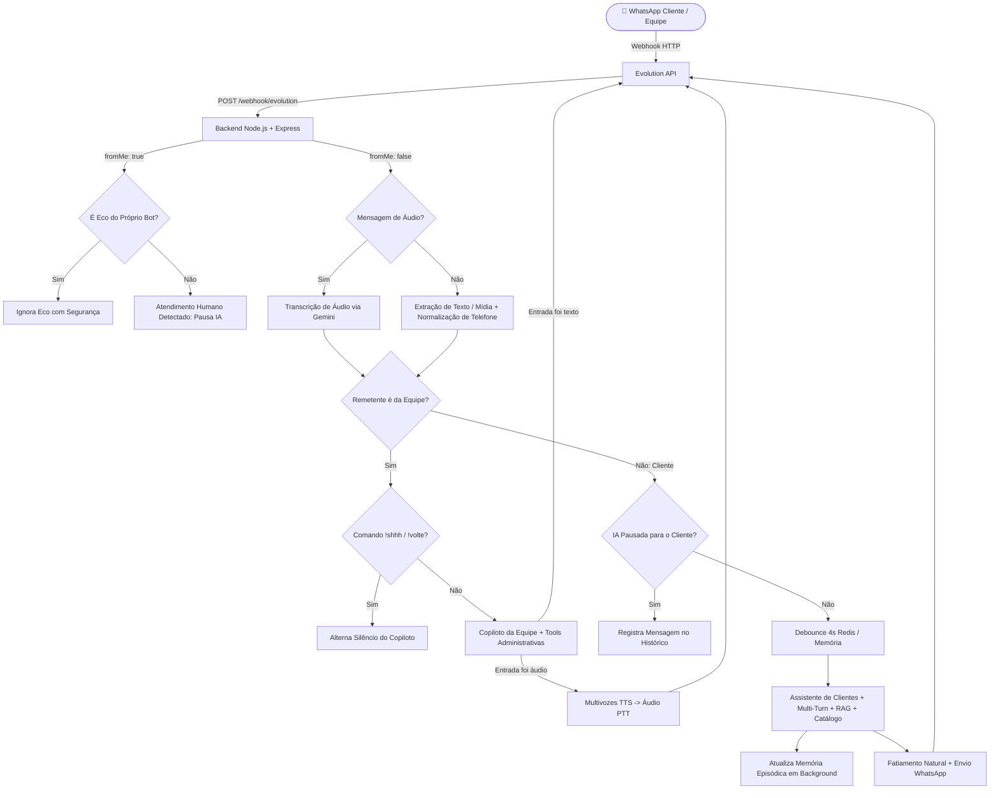

# 🤖 Plataforma SaaS Multitenant de Atendimento Inteligente via WhatsApp

<div align="center">


<br/>

**Plataforma SaaS completa (Backend em Node.js + Painel Administrativo em Next.js 16) para atendimento comercial, triagem, dossiês de clientes e catálogo inteligente via WhatsApp.**

*Projetada originalmente para Escritórios de Advocacia e expandida com arquitetura Multi-Segmento para Comércio, Informática e Assistência Técnica.*

</div>

---

## 📑 Sumário

- [Visão Geral da Plataforma](#-visão-geral-da-plataforma)
- [Principais Diferenciais de Engenharia](#-principais-diferenciais-de-engenharia)
- [Arquitetura & Fluxo de Atendimento](#-arquitetura--fluxo-de-atendimento)
- [Os Dois Agentes Configuráveis por Empresa](#-os-dois-agentes-configuráveis-por-empresa)
- [Ferramentas Nativas (Function Calling)](#-ferramentas-nativas-function-calling)
- [Painel Administrativo (`admin-panel/`)](#-painel-administrativo-admin-panel)
- [Estrutura do Repositório](#-estrutura-do-repositório)
- [Banco de Dados & Migrações SQL (`sql/`)](#-banco-de-dados--migrações-sql-sql)
- [Configuração & Execução Local](#-configuração--execução-local)
- [Testes Automatizados](#-testes-automatizados)
- [Deploy em Produção](#-deploy-em-produção)

---

## 🎯 Visão Geral da Plataforma

O `saas-chatbot` é uma solução multitenant ponta a ponta composta por dois serviços integrados no mesmo repositório:

1. **Motor de Atendimento & API (`src/`)**: Servidor **Node.js 22 + Express + TypeScript** de baixíssimo consumo de memória (~90 MB RAM), conectado à **Evolution API**, **Google Gemini** (com failover automático entre modelos primário e contingência), **Supabase (`pgvector` + `pg_trgm` + `Storage`)**, **Redis** (debounce atômico com fallback automático em memória), **Google Calendar** e **Multivozes TTS**.
2. **Painel Administrativo Comercial (`admin-panel/`)**: Aplicação web **Next.js 16 + React 19 + Tailwind CSS v4 + shadcn/ui** para gestão completa de múltiplos escritórios/empresas, conexão WhatsApp via QR Code, curadoria de conversas, dossiês individuais de clientes, base de conhecimento com simulador visual e gestão de catálogo/estoque com importação de planilhas.

---

## 🧠 Principais Diferenciais de Engenharia

### 1. Contexto Multi-Turn Nativo & Memória Episódica de Longo Prazo
- **Histórico Estruturado (`Content[]`)**: As mensagens do banco são convertidas em turnos reais `user` ↔ `model` da API do Gemini (`buildGeminiChatTurns`), mesclando bolhas consecutivas, sinalizando intervenções humanas (`[Atendente Humano]`) sem quebrar o papel da IA e preservando o prefixo estático do `systemInstruction` para máximo aproveitamento de **Implicit Prefix Caching**.
- **Envelope `<session_context>`**: Variáveis voláteis da sessão (horário local `America/Sao_Paulo`, dados do cliente, status e memória) são injetadas apenas no rodapé do prompt, enquanto variáveis de identidade (`{{ agent_name }}`, `{{ external_agent_name }}`, `{{ internal_agent_name }}`, `{{ tenant_name }}`) parametrizam os prompts sem nomes engessados.
- **Memória Episódica (`memory.service.ts`)**: Resumo executivo persistente em `clients.metadata.memory_summary`, atualizado de forma assíncrona e econômica a cada nova janela de interações e enriquecido automaticamente ao concluir uma triagem (`convert_lead`).

### 2. Base de Conhecimento Dual-Scope Zero-Trust (RAG + Dossiê do Cliente)
- **Dois Escopos na Mesma Estrutura Vetorial (`1536d` HNSW)**:
  - **Institucional (`client_id IS NULL`)**: Regras de negócio, honorários/serviços, endereços, políticas e perguntas frequentes da empresa.
  - **Dossiê Individual do Cliente (`client_id = UUID`)**: Andamentos processuais, ordens de serviço, contratos ou notas específicas daquele cliente.
- **Segurança Zero-Trust no Banco (`match_knowledge_base`)**: Documentos de dossiê nascem restritos à equipe interna (`visible_to_client = false`) e só podem ser consultados pelo Assistente de Clientes se liberados explicitamente, sempre travados pelo `client_id` autenticado do WhatsApp em atendimento (nunca por argumento livre da IA).
- **Simulador de Consulta com Destaque Visual**: No painel, o gestor testa qualquer pergunta na *Visão Cliente* ou *Visão Equipe*, visualiza a resposta simulada exata do WhatsApp e vê grifados em amarelo (`<mark>`) os trechos exatos dos documentos que fundamentaram a resposta.

### 3. Catálogo Híbrido de Produtos & Fotos no WhatsApp (Multi-Segmento)
- Ativável por empresa (`classifier_rules.enable_product_catalog`), permitindo atender tanto **Escritórios de Advocacia** quanto **Lojas de Informática, Comércio e Assistências Técnicas**.
- **Busca Híbrida Ultrarrápida (`product.service.ts`)**: Combina filtro determinístico de estoque e teto de preço (`stock_quantity > 0`), índice trigrama (`pg_trgm`) com expansão de sinônimos em português e busca vetorial semântica (`match_products` 1536d).
- **Importador Inteligente de Planilhas (`.xlsx` / `.csv`)**: Reconhece automaticamente colunas de ERPs brasileiros (`Código/SKU`, `Produto/Descrição`, `Preço`, `Estoque`, `Categoria`), converte moeda `R$ 1.299,90`, atualiza preços/saldos via *upsert* **sem sobrescrever fotos já cadastradas** e permite upload de fotos em lote vinculando arquivos pelo SKU (`SKU.jpg`).
- **Envio Real de Fotos (`send_product_photo`)**: Envia a foto oficial do produto hospedada no Supabase Storage diretamente no WhatsApp do cliente com proteção anti-eco (`registerSentMediaEcho`) para não pausar a IA indevidamente.

### 4. Normalização Canônica de Telefones Brasileiros & Anti-Eco
- Utilitário dedicado (`src/utils/phone.ts`) que normaliza JIDs da Evolution API (removendo sufixos `:device` e unificando celulares brasileiros com ou sem o 9º dígito após o DDD), evitando cadastros duplicados e garantindo vínculo íntegro entre `clients`, `messages` e `team_members`.

### 5. Alta Disponibilidade & Failover Automático de IA
- **Failover Instantâneo de Modelo (`GEMINI_FALLBACK_MODEL`)**: Caso o modelo primário sofra picos temporários de demanda (`503` / `429` / timeout) na API do Google, os orquestradores alternam automaticamente para o modelo de contingência sem atrasar o atendimento.
- **Debounce Resiliente**: Agrupa mensagens picadas em janelas de 4 segundos via Redis e assume automaticamente buffer em memória local caso o Redis não esteja disponível.

---

## 🏛️ Arquitetura & Fluxo de Atendimento



---

## 🤖 Os Dois Agentes Configuráveis por Empresa

Cada empresa cadastrada define livremente o nome, a personalidade e as regras de seus dois agentes:

1. **Assistente de Clientes (Externo — ex.: *Karol*, *Lohanna*)**
   - Recepciona clientes 24/7, realiza triagem consultiva, consulta documentos institucionais e o dossiê liberado do próprio cliente, verifica agenda ou estoque real de produtos, envia fotos de itens quando solicitado e aciona a equipe humana sempre que necessário.
2. **Copiloto da Equipe (Interno — ex.: *Atlas*)**
   - Reconhece automaticamente sócios, advogados, técnicos e gestores cadastrados na aba *Equipe*.
   - Consulta dossiês completos (incluindo notas internas sigilosas), gera resumos diários de atendimento, altera status de clientes por comando natural e responde por **áudio (TTS)** quando acionado por mensagem de voz.

---

## 🛠️ Ferramentas Nativas (Function Calling)

| Ferramenta | Escopo | Finalidade |
| :--- | :---: | :--- |
| `save_client_name` | Cliente | Salva ou atualiza o nome do cliente assim que informado na conversa |
| `convert_lead` | Cliente | Registra triagem qualificada, atualiza a memória do cliente e notifica o grupo da equipe |
| `human_escalation` | Cliente | Pausa a IA imediatamente e alerta a equipe com resumo e link direto `wa.me/` |
| `notify_team` | Cliente | Envia aviso operacional ao grupo da equipe sem interromper o atendimento automático |
| `check_calendar` | Ambos | Consulta horários livres reais no Google Calendar respeitando expediente e almoço |
| `schedule_event` | Cliente | Agenda compromissos no Google Calendar com geração opcional de link Google Meet |
| `search_knowledge_base` | Ambos | Busca vetorial com isolamento multitenant e trava Zero-Trust por escopo (Cliente vs Equipe) |
| `search_products` | Ambos* | Busca híbrida no catálogo de produtos com estoque disponível, preços e sinônimos |
| `send_product_photo` | Cliente* | Envia foto real do produto via WhatsApp com legenda comercial automática |
| `get_daily_summary` | Equipe | Consolida o relatório das conversas e atendimentos das últimas 24 horas |
| `update_client_status` | Equipe | Pausa, reativa ou altera o estágio de um cliente por nome ou telefone |

*\*Ferramentas de catálogo habilitadas dinamicamente nas empresas com módulo de Catálogo de Produtos ativo.*

---

## 🖥️ Painel Administrativo (`admin-panel/`)

Interface SaaS construída em **Next.js 16 (App Router)** com autenticação JWT HttpOnly (`jose` + `bcryptjs`) e comunicação segura via Server Actions:

- **Visão Geral (`/dashboard`)**: Indicadores globais, saúde das conexões e feed curado (*Round-Robin*) de conversas recentes com *deep-link* direto para o chat do cliente.
- **Gestão por Empresa (`/tenants/[id]`)**:
  - **Resumo**: Métricas operacionais da unidade e últimas interações reais (excluindo equipe interna).
  - **Clientes & Dossiês**: Histórico completo de chat, edição protegida de cadastro, visualização da **Memória do Cliente** e gerenciamento do **Dossiê Individual** com controle de visibilidade.
  - **Catálogo & Estoque**: Cadastro de produtos, upload de fotos no Supabase Storage, importação em massa de planilhas `.xlsx`/`.csv` e vinculação automática de fotos em lote pelo SKU.
  - **Base de Conhecimento**: Gestão de documentos institucionais com fatiamento automático e **Simulador de Consulta** com resposta simulada + grifo automático dos trechos utilizados.
  - **Equipe**: Cadastro de membros autorizados a conversar com o Copiloto da Equipe e comandos rápidos (`!shhh` / `!volte`).
  - **Agentes de IA**: Editor de prompts com variáveis dinâmicas, temperatura, regras de triagem e ativação do módulo de catálogo.
  - **WhatsApp & Webhook**: Conexão via QR Code em tempo real, seleção do grupo de alertas e configuração do Webhook na Evolution API com 1 clique.
  - **Agenda**: Expediente comercial, intervalo de almoço e credenciais OAuth2 do Google Calendar.

---

## 📁 Estrutura do Repositório

```text
saas-chatbot/
├── admin-panel/                     # Painel Administrativo SaaS (Next.js 16 + React 19 + Tailwind v4)
│   ├── src/
│   │   ├── app/                     # Rotas App Router (/login, /dashboard, /tenants, /settings) + Server Actions
│   │   ├── components/              # Módulos visuais (Catálogo, Base de Conhecimento, Clientes, Equipe, IA, UI)
│   │   └── lib/                     # Clientes Supabase SSR/Service Role, JWT Auth, Evolution API e Backend Client
│   ├── .env.example                 # Exemplo de variáveis de ambiente do painel
│   └── package.json
├── sql/                             # Migrações idempotentes para o SQL Editor do Supabase
│   ├── migration_saas.sql           # Estrutura base multitenant (tenants, tenant_configs, clients, messages, team)
│   ├── match_knowledge_base.sql     # Tabela knowledge_base + índices HNSW + RPC Zero-Trust Dual-Scope
│   └── products_catalog.sql         # Tabela products + índices pg_trgm/HNSW + RPC match_products
├── src/                             # Motor Backend de Atendimento (Node.js 22 + Express + TypeScript)
│   ├── config/env.ts                # Validação de ambiente com Zod
│   ├── integrations/                # Clientes Evolution API, Supabase, Redis (com fallback) e Google Calendar
│   ├── routes/                      # Rotas /webhook/evolution, /api/knowledge e /api/products
│   ├── services/                    # Orquestradores de IA, Memória Episódica, RAG, Produtos, Debounce, Crons, TTS
│   ├── tools/                       # Declarações e executores de Function Calling do Gemini
│   ├── types/                       # Contratos TypeScript compartilhados
│   └── utils/                       # Compilador de prompts (<session_context>), normalizador de telefones e logger
├── tests/                           # Suíte de testes automatizados (Vitest)
├── AGENTS.md                        # Diretrizes de produto, UI/UX e padrões técnicos do repositório
├── .env.example                     # Exemplo de variáveis de ambiente do backend
└── package.json
```

---

## 🗄️ Banco de Dados & Migrações SQL (`sql/`)

Execute os scripts abaixo no **SQL Editor** do Supabase (todos são idempotentes e seguros para bancos já existentes):

1. [`sql/migration_saas.sql`](sql/migration_saas.sql) — Cria/adapta `tenants`, `tenant_configs`, `clients`, `messages`, `team_members` e `leads_control`.
2. [`sql/match_knowledge_base.sql`](sql/match_knowledge_base.sql) — Configura `pgvector` (`1536` dimensões), índices HNSW e a função `match_knowledge_base` para documentos institucionais + dossiês de clientes.
3. [`sql/products_catalog.sql`](sql/products_catalog.sql) — Cria a tabela `products`, índices `pg_trgm` + `HNSW` e a função `match_products` para o catálogo híbrido.
4. **Supabase Storage**: Crie um bucket público chamado `product-images` caso utilize envio de fotos de produtos no WhatsApp.

---

## ⚙️ Configuração & Execução Local

### Pré-requisitos
- **Node.js 22+**
- Projeto no **Supabase** (PostgreSQL + `pgvector`)
- Instância na **Evolution API**
- Chave de API do **Google AI Studio (Gemini)**
- **Redis** *(opcional em desenvolvimento — o backend ativa fallback em memória automaticamente)*

### 1. Backend (`:3000`)

```bash
# Na raiz do repositório
cp .env.example .env
# Preencha suas chaves no arquivo .env (sem UTF-8 BOM)

npm install
npm run dev
```

### 2. Painel Administrativo (`:3001`)

```bash
cd admin-panel
cp .env.example .env.local
# Preencha as chaves do Supabase, JWT_SECRET e BACKEND_API_URL=http://localhost:3000

npm install
npm run dev
```

Acesse o painel em `http://localhost:3001`.

---

## 🧪 Testes Automatizados

O projeto conta com suíte automatizada em **Vitest** cobrindo compilação de prompts, histórico multi-turn, normalização de telefones, trava Zero-Trust de RAG, debounce, anti-eco da Evolution API e rotas HTTP:

```bash
npm run typecheck
npm test
```

---

## 🚀 Deploy em Produção

### Backend (Node.js / PM2)
```bash
npm run build
pm2 start dist/main.js --name "saas-chatbot-backend" -i 1
pm2 save
```

### Painel Administrativo (Next.js 16)
```bash
cd admin-panel
npm run build
npm start
```

Na aba **WhatsApp** de cada empresa no painel, basta clicar em **Configurar Automaticamente** para registrar o endpoint `POST /webhook/evolution` (`MESSAGES_UPSERT`) diretamente na Evolution API.
